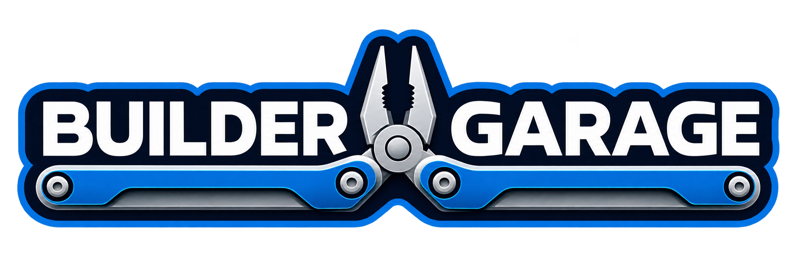

<p align="center">
  
</p>

**An Agentic Engineering System for Builders**

Builder Garage is an open-source, project-embedded, extensible agentic engineering framework: a system of engineering practices, standards, architecture, roles, contracts, and workflows for responsible software construction with AI agents.

## Project status

Builder Garage is at its foundation stage.

**What exists today** is the initial `garage` command-line foundation and the project's engineering documentation: the reusable engineering [skills](#skills), the [operating model](#operating-model) and review contract they implement, the [engineering principles](docs/principles.md) and [history](docs/history.md) behind them, and governance and contribution process.

The CLI can display help and version information, initialize, upgrade, validate, show, and change a project's `.garage/config.yaml`, record and read private developer-local workflow events, install and verify the canonical skills and the manuals a project adopts at a project's harness targets, show the read-only workflow status of an issue or pull request from GitHub, explicitly start a read-only loopback-only local project view, and, only when asked, check GitHub for a newer release. `garage update check` is the only command that contacts GitHub directly, and no command checks for updates on its own. It does not execute workflows, configure agents, connect to AI providers, load plugins, or provide remote services. No library, adapter, SDK, or runtime for the conceptual components has been implemented. Release automation builds attested archives of the CLI itself, with a signed checksum manifest ([ADR 0003](docs/adr/0003-release-distribution.md)); releases are published from `v0.1.1`.

## Architectural direction

The approved direction is recorded in [docs/architecture.md](docs/architecture.md). In summary:

- **Project-embedded.** Builder Garage is meant to operate from inside the project it serves, alongside that project's repository, issues, and pull requests, rather than as a separate hosted service.
- **CLI-first.** The `garage` command-line interface is the primary interface. Libraries, adapters, and potentially independent or distributed execution may follow.
- **Extensible.** Projects that adopt it are expected to adapt and extend it.
- **Single repository**, initially.
- **Evolutionary.** Detailed design decisions are made through discovery within the lifecycle of the change that needs them, not in advance.

## The `garage` CLI

### Capabilities

The initial executable provides these entry points:

| Command | Behavior |
| --- | --- |
| `garage --help` | Describes Builder Garage and lists the available commands. |
| `garage version` | Reports the build version. `install.sh` and `make build` derive it from Git tags, for example `v0.1.0`; a plain `go build` reports `dev`. See [Versions](#versions). |
| `garage init` | Creates or upgrades `.garage/config.yaml` in the current project directory. See [Project configuration](#project-configuration). |
| `garage config validate` | Checks `.garage/config.yaml` against the configuration schema, read-only, and reports every problem. |
| `garage config show`, `get` | Show every setting in plain language, or print one setting's value. |
| `garage config set`, `unset`, `add`, `remove` | Change one setting, validated against the complete configuration, confirmed, and written atomically. |
| `garage record` | Records a private workflow event, such as an implementation handoff or a review verdict, in this developer's local history. See [Local workflow history](#local-workflow-history). |
| `garage history list`, `garage history path` | List this repository's local workflow events, or every local history file with `--all-local`, and show where the history is stored. Offline and read-only. See [Local workflow history](#local-workflow-history). |
| `garage skills install`, `garage skills verify` | Install or update the canonical skills embedded in the binary, and the manuals the project adopts, at the project's declared harness targets, and check them read-only. See [Skill installation](docs/skill-installation.md). |
| `garage status` | Shows the workflow status of one issue or pull request, read from GitHub in one query, and at most one follow-up. See [Workflow status](#workflow-status). |
| `garage web` | Explicitly starts one read-only, IPv4-loopback-only project view. It prints a local URL and access code; `--open` opens a one-time local authorization bootstrap. Each instance has one project and port. |
| `garage update check` | Reports this version and the latest published release, read once from GitHub, and, when the release is newer, lists the documented ways to update. It downloads and installs nothing. |

### Project configuration

`.garage/config.yaml` is the sole canonical source of a project's configured choices. Its `project` section holds the project's values at the extension points the [extension-point registry](docs/extension-points.md) declares. Its `tooling` section holds Garage tooling settings, which grant no workflow authority. The format and lifecycle are in [Project configuration](docs/configuration.md).

- **Required values.** Some choices have no default: discovery applicability, and the Workflow Owner, change acceptor, and product-intent acceptor. Otherwise each must be given as a flag, and `init` fails and writes nothing if one is missing. `garage init --help` lists every flag.
- **Guided setup.** In an interactive terminal, `garage init` walks through each choice in plain language when it creates a configuration, with numbered menus and each default shown. It asks only about choices that no flag supplies. It explains the human responsibilities, lets you reuse an authority you already named, and rejects placeholder answers such as `ROLE`. When upgrading an existing configuration, it asks only for missing required values. Either way it shows a summary and writes only after you confirm.
- **Upgrade in place.** Running `garage init` again keeps every existing value and comment, adds only missing settings, and migrates a schema version 1 file to version 2. It never overwrites a configured value, and there is no `--force`. If the existing file is invalid, `init` stops without changing it and explains the correction required.
- **Validation.** `garage config validate` checks the schema and every mechanically checkable value. It does not certify that a configured authority is human, or anything about agents or workflow state.
- **Reading and changing settings.** `garage config show` lists every setting in plain language with its name, and `garage config get` prints one value. `set`, `unset`, `add`, and `remove` change one setting, using `init`'s flag names and formats, for example `garage config set integration-branch main` or `garage config add manual go`. Each change is validated against the complete configuration and shown for confirmation; outside a terminal it needs `--yes`. A change that would leave the configuration invalid is refused, and comments on untouched settings are kept. The commands never commit, push, or open pull requests. Details are in [Project configuration](docs/configuration.md#reading-and-changing-settings-garage-config).

Builder Garage's own configuration is generated by `garage init` and validated in CI; see its [skill-adoption profile](docs/skill-adoption.md#configuration).

### Local workflow history

`garage record` keeps a private, best-effort annotation of what a developer's agents did:

```sh
garage record --issue 39 --type implementation --outcome ready \
  --role "Agent #1" \
  --url https://github.com/OWNER/REPO/issues/39#issuecomment-123
```

- **Private and local.** Events are stored in the user cache directory, keyed to the repository, and are never written inside the repository or sent anywhere. The command works without GitHub access.
- **Bounded.** At most 500 events are kept per repository.
- **Minimal.** Only a timestamp, the repository key, the issue or pull request number, the event type, the outcome, an optional link to the durable GitHub record, an optional artifact identity, and an optional explicitly recorded role are stored. Branch names, prompts, conversation text, diffs, file contents, environment values, and tokens are not.
- **Not evidence.** GitHub Issue and pull request records are authoritative. Local history never authorizes, blocks, or advances work, and losing it loses nothing that matters.
- **Best effort.** If an event cannot be recorded, `garage record` prints a warning and still exits successfully.
- **Safe to run concurrently.** Recordings to the same repository's history, from separate processes, clones, or worktrees, take turns through an operating-system lock on a file beside the history, so each keeps its event. If the history stays locked for 5 seconds, the event is not recorded and a warning is printed. The lock serializes only these local writes; it never coordinates agents or workflow.

Run `garage record --help` for the accepted event types and outcomes. The design is recorded in the [#19 decision](https://github.com/bdonaldharris/builder-garage/issues/19#issuecomment-6837362562).

**Reading the history.** `garage history` reads it back. It is offline and read-only: it never contacts GitHub, never opens a stored link, and never changes the history.

```sh
garage history list                  # this repository's events, oldest first
garage history list --issue 39       # one issue (or --pr N for a pull request)
garage history path                  # where this repository's history is stored, and its key
garage history list --all-local      # every local history file, each with its own events
garage history list --format jsonl   # one JSON object per line, for scripts
```

- **Where it is stored.** One file per repository identity, `<key>.jsonl`, in:
  - macOS: `~/Library/Caches/builder-garage/history/`;
  - Linux: `$XDG_CACHE_HOME/builder-garage/history/`, or `~/.cache/builder-garage/history/`;
  - Windows: `%LocalAppData%\builder-garage\history\`.
- **The key** is a hash of the checkout's `origin` URL, or of its git directory when there is no `origin`. Clones and worktrees with the same `origin` share one history. Changing `origin`, for example after the repository is renamed, starts a new file, and `garage history list` and `garage status` then show only the new one.
- **`--all-local`** lists every history file, whichever repository it belongs to, with its path, key, event count, date range, and the GitHub repositories its events link to. It marks a file "events link to this repository" when every link in it points to this checkout's `origin`; that is a label read from the stored links, not proof. Each file's events are listed under it. Histories are never merged.

### Workflow status

`garage status 48` shows the workflow status of issue or pull request #48 in the repository's GitHub repository, including closed and merged ones. Legacy `garage status '#48'` remains supported; explicit forms are `garage status issue 48`, `garage status pr 48`, and canonical HTTPS issue/PR URLs. An explicit kind must match the actual artifact, and URL host/project checks apply before access. [Schema-v3 forge configuration](docs/configuration.md#forge-identity-schema-3) optionally selects identity; existing schema-v2 GitHub projects continue unchanged. GitLab configuration is preparatory: its observation adapter and complete support are not available in this slice.

Status behavior:

- **GitHub is the authority.** Status reads GitHub through the [`gh`](https://cli.github.com/) command, in one read-only query, plus at most one follow-up query when a pull request's governing issues must be read separately (below; [#137 decision](https://github.com/bdonaldharris/builder-garage/issues/137#issuecomment-6992337101)). It writes nothing. Garage never stores a token. It never polls or waits, and it never assigns, invokes, or advances an agent. The next eligible action it shows is information only.
- **Evidence, labeled.** Each line names its source and basis. A fact read from GitHub, or a comparison of recorded values, is *checked*. A verdict or a claim of separate execution contexts is *asserted*. A pull request head's [artifact identity](docs/review-evidence.md) is recomputed only when the commit is already local. Nothing is fetched. In a partial clone, where git fetches missing objects on demand, status does not recompute and says so.
- **Whose records count.** A workflow record counts only when its author's GitHub association is owner, member, or collaborator. A record edited after posting is flagged. Human acceptance is evidenced only by an approving GitHub review. These rules are recorded in the [#40 decision](https://github.com/bdonaldharris/builder-garage/issues/40#issuecomment-6853390215).
- **Degrades clearly.** Without `gh`, or without `gh` authentication, status says that GitHub was not consulted, reports no workflow state, and exits with an error. Local history is shown as a separate annotation for origin-project targets, and is never used for any gate. Cross-project status omits origin-project history, including when the provider is unavailable. An existing configuration that cannot be read safely stops status before provider access; an absent configuration retains legacy GitHub discovery.

#### Governing issues and pull-request kinds

A pull request's description declares its governing issues and its kind in two sections, which the [pull request template](.github/PULL_REQUEST_TEMPLATE.md) provides:

- **`## Governing issue`.** Issue references in this repository, written as `#N`, `Closes #N`, `Fixes #N`, `Resolves #N`, or `Refs #N`.
  - A reference outside the section, one qualified with another repository (`owner/repo#N`), or a malformed one is not a governing issue.
  - GitHub links a closing keyword to its issue only when the pull request targets the default branch. So status reads the section whenever the base is another branch, or the pull request closes no issue. The issues the section names that its closing references do not supply are read in the follow-up query, with their workflow records, up to five.
  - In `github.com/bdonaldharris/builder-garage`, status reads the #192 registry for PRs. When a valid registry identifies an enrolled issue or a PR explicitly declares stack handling, status also reads the relevant predecessor PR chain. Other repositories are not classified from stack registries or branch names.
  - For an issue, status also lists the pull requests in this repository whose Governing issue section names it.
- **`## Pull request kind`.** Exactly one of `implementation`, `promotion`, `hotfix`, `clean synchronization`, or `conflicted synchronization`.
- **`## Stack dependency` / `## Stack maintenance`.** Optional YAML declarations for the narrowly scoped #192 stack exception. A declaration alone never grants eligibility; status validates it against the latest registry. If the registry is unavailable or invalid, an undeclared E1 PR reports membership unknown and retains ordinary gates, while an explicit declaration grants no exception.

Status reads the declared kind first, then checks it against the base and head the kind permits. E1 is the configured integration branch; the release branch is E11 ([extension points](docs/extension-points.md#e11-release-branch)).

| Kind | Base | Head |
| --- | --- | --- |
| implementation | E1 | an issue branch |
| promotion | the release branch | `release/vX.Y.Z-rc.N` |
| hotfix | the release branch | a hotfix branch, for an issue carrying a [hotfix designation](docs/extension-points.md#e11-release-branch) |
| clean synchronization | E1 | the release branch |
| conflicted synchronization | E1 | `backmerge/vX.Y.Z` |

The `implementation` kind has one narrow destination exception: a feature issue in the latest #192 registry targets its registered direct-prerequisite branch until that PR merges, then the branch the prerequisite's change was merged into, followed through any later merge of that branch; its `Stack dependency` must match that permitted target. Status judges an open PR by the target permitted now and a merged PR by the target permitted when it merged, and reads declarations from the current PR body only. A maintenance PR may target its registered branch from a temporary `maintenance/stack-192/...` head with `Stack maintenance`. Both remain kind `implementation`.

- **A declared kind whose base and head fit** is reported as that kind. A declared promotion's head must be exactly `release/vX.Y.Z-rc.N`, and a declared conflicted synchronization's exactly `backmerge/vX.Y.Z`, with `X.Y.Z` written as a release tag is and `N` from 1.
  - Only a declared **promotion** or **clean synchronization** is exempt from implementation-review gates. Its governing issues, checks, human acceptance, and Environment / Deployment Requirements are still reported.
  - Every other kind is evaluated with every gate.
- **A declared kind that does not fit,** or an unrecognized one, is reported as a mismatch, and every implementation gate is evaluated. A mismatch never relaxes a gate.
- **The #192 exception is registry-scoped.** Status checks repository identity, the single governing feature issue, sequence, branch, direct prerequisite, target, prerequisite PR, and current target commit. Retargeting or a stale artifact reference makes equivalence unavailable and invokes the ordinary minimum PR-review triggers. Stack and maintenance PRs never skip implementation-review gates.
- **No declared kind, with E1 as the base:** status infers clean synchronization when the head is the release branch, conflicted synchronization when it is a `backmerge/` branch, and implementation otherwise. An inferred kind is evaluated with every gate.
- **No declared kind, with any other base:** status infers nothing, never a hotfix or a promotion. It reports that the base is not E1, and evaluates every gate.

### Build from source

Source builds require **Go 1.27.4**, the version declared in [`go.mod`](go.mod). Compiled executables are standalone and do not require a Go installation at run time.

#### Versions

`garage` follows Semantic Versioning, starting at `v0.1.0`. Versions are Git tags ([ADR 0002](docs/adr/0002-semantic-versioning.md)). `v0.1.0` is a tag-only source snapshot. Release archives are built from version tags by the [release workflow](.github/workflows/release.yml), and the first published release will be `v0.1.1` ([ADR 0003](docs/adr/0003-release-distribution.md)); none is published yet.

`install.sh` and `make build` derive the version `garage version` reports from the checkout:

| Checkout | Reported version |
| --- | --- |
| Exactly at a version tag, with no local changes | The tag, for example `v0.1.0` |
| Commits after the tag | Git's descriptive form, for example `v0.1.0-3-gabc1234` |
| No version tag reachable, for example a shallow clone without tags | The abbreviated commit, for example `abc1234` |
| Local changes, untracked files included | Any of the above with `-dirty` appended |
| No Git metadata, for example an extracted source archive | `dev` |

Set `VERSION` to override it, for example `make build VERSION=1.2.3` or `VERSION=1.2.3 ./install.sh`. A plain `go build` derives nothing and reports `dev`, unless a version is supplied at link time, as in [Build by hand](#build-by-hand).

#### Install a release

On macOS and Linux, [`install.sh`](install.sh) can install a published release without Git or Go. It downloads the release's archive for your platform, its checksum manifest, and the manifest's signature. Then, **before installing anything**, it checks two things:
- the manifest's signature, with [cosign](https://docs.sigstore.dev/cosign/system_config/installation/), pinned to this repository's release workflow at that tag;
- the archive, against the manifest.

If either check fails or cannot run, it installs nothing. It requires `curl`, `tar`, and **cosign v3 or later**.

Fetch the installer from a release tag, and install that same release:

```sh
TAG=vX.Y.Z   # a release tag; install.sh's release mode ships from the first release after v0.2.1
curl -fsSL "https://raw.githubusercontent.com/bdonaldharris/builder-garage/$TAG/install.sh" | sh -s -- --version "$TAG"
garage version
```

- **Tags are immutable**, so that URL always serves the same installer. Read it first if you like, as with any piped installer.
- **Without `--version`,** it installs the latest release.
- **Like the source install below,** it installs in `~/.local/bin` (or `--install-dir PATH`) for the current user, never edits shell startup files or `PATH`, and does not install skills.
- **Re-running it replaces the installed binary in place,** for example to move to a newer release.
- **To find out whether a newer release exists,** run `garage update check`, from the first release after `v0.2.2`. It makes one request to GitHub, only when you run it, and lists the update command for each way of installing `garage`. It installs nothing itself.
- **The Windows executables are not yet platform-signed** ([Platform trust](docs/release-verification.md#platform-trust)). The macOS executables are Developer ID signed and notarized from the first release built after macOS signing was added; a `curl` download is not quarantined, so macOS runs earlier, unsigned ones too.
- **Windows:** a PowerShell installer follows platform signing ([#125](https://github.com/bdonaldharris/builder-garage/issues/125)). On Windows, download and verify a release as [Verifying a release](docs/release-verification.md#windows-powershell) shows.

On macOS and Linux, you can also install a release with npm, from the first release published there ([#158](https://github.com/bdonaldharris/builder-garage/issues/158)). It needs Node.js 20 or later:

```sh
npm install -g @buildergarage/garage
garage version
```

Always use the full name, `@buildergarage/garage`: the unscoped npm package `garage` is unrelated. Windows is not offered through npm yet. See [npm](docs/release-verification.md#npm) for how the packages relate to the release, and how to verify them.

#### Install from source

On macOS and Linux, `install.sh` also builds `garage` from a checkout. Run as a file in a checkout, that is what it does, unless you pass `--release`:

```sh
git clone https://github.com/bdonaldharris/builder-garage.git
cd builder-garage
./install.sh
garage version
```

The installer builds `garage` with the same flags as `make build`, and installs it in `~/.local/bin`. To install it somewhere else, use `--install-dir PATH`. It reports the version derived from the checkout, as described under [Versions](#versions); set `VERSION` to override it, as with `make build`. Running it again, for example after `git pull`, upgrades the installed binary in place.

- It may create the install directory. It never edits shell startup files or `PATH`. When the install directory isn't on `PATH`, it says what to add.
- It stops, and installs nothing, when the Go version in `go.mod` isn't available. It never lets Go download a toolchain.
- Apart from Go's own build and module caches, and a temporary build directory it removes, it writes nothing outside the install directory: not the checkout, and not any project.
- It does not install skills. Skills are installed separately, per project, with [`garage skills install`](docs/skill-installation.md).

Release archives for macOS, Linux, and Windows, with a signed checksum manifest and attestations, are published from `v0.1.1` onwards. Download one from the [Releases page](https://github.com/bdonaldharris/builder-garage/releases) and verify it as described in [Verifying a release](docs/release-verification.md), or let [`install.sh`](#install-a-release) do both on macOS and Linux.

From `v0.2.0`, releases also carry `.deb` and `.rpm` packages for Linux on amd64 and arm64. A package installs `garage` system-wide at `/usr/bin/garage`, and `apt` or `dnf` upgrades and removes it. Verify it before installing, as [Verifying a release](docs/release-verification.md#linux-packages) shows. `install.sh` installs for one user in `~/.local/bin` instead: use one or the other, so that only one `garage` is on your `PATH`.

From `v0.5.0`, macOS releases also carry a signed, notarized, stapled `.pkg` for each architecture. It installs the package-owned command at `/usr/local/bin/garage` through a versioned payload under `/usr/local/lib/buildergarage`. Verify it before installing, and use its explicit uninstall helper before switching to `install.sh`, npm, or Homebrew; see [macOS installer packages](docs/release-verification.md#macos-installer-packages). The installer refuses to overwrite a command owned by another method, and `PATH` order determines which remaining command runs.

On macOS and Linux, Homebrew users can install the release from Builder Garage's tap: `brew tap bdonaldharris/tap`, `brew trust --tap bdonaldharris/tap`, then `brew install --cask bdonaldharris/tap/garage` ([Homebrew](docs/release-verification.md#homebrew-macos-and-linux)). Use the full name: homebrew/core has an unrelated formula also called `garage`. The cask installs the signed, notarized macOS archive or the Linux archive for your architecture.

#### Build by hand

Clone the repository, then build from its root:

```sh
go build ./cmd/garage
./garage --help
./garage version
```

A plain `go build` reports `dev`. To supply a version without adding a metadata framework:

```sh
go build -ldflags "-X main.version=1.2.3" ./cmd/garage
./garage version
```

The `Makefile` provides the same build, and derives the version from Git tags as described under [Versions](#versions) unless `VERSION` is set:

```sh
make build
make build VERSION=1.2.3
```

### Initialize another project

Run the compiled executable from the root of the project you want to initialize:

```sh
cd /path/to/project
/path/to/garage init
```

In a terminal, `init` guides you through each choice and asks you to confirm a summary before writing. To supply the values noninteractively instead:

```sh
/path/to/garage init --discovery implementer-judgment \
  --workflow-owner "lead maintainer" --change-acceptor maintainer \
  --product-intent-acceptor "Workflow Owner"
/path/to/garage config validate
```

This creates `/path/to/project/.garage/config.yaml`. Running `init` again leaves a complete configuration unchanged.

### Develop and validate

The repository uses Go's standard testing package. The focused checks are:

```sh
go test ./...
go vet ./...
make fmt-check
```

Run the full local validation, including a native build and cross-compilation:

```sh
make check
```

Exercise the source installer, which installs only into temporary directories:

```sh
sh .github/scripts/test-install.sh
```

`make cross` writes executables for macOS, Linux, and Windows on amd64 and arm64 to `dist/`. On environments without `make`, the underlying commands are standard `go test`, `go vet`, `gofmt`, and `go build` commands; see [`Makefile`](Makefile) for the exact cross-compilation matrix. Pull requests run the same categories of validation in [GitHub Actions](.github/workflows/ci.yml), with tests on Linux, macOS, and Windows.

### Current limitations

- Releases are published from `v0.1.1`. The [release workflow](.github/workflows/release.yml) builds archives with GoReleaser, with a signed checksum manifest and attestations ([ADR 0003](docs/adr/0003-release-distribution.md)). On macOS and Linux, [`install.sh`](#install-a-release) installs a verified release, or builds from source.
- Windows executables are not yet Authenticode-signed ([#122](https://github.com/bdonaldharris/builder-garage/issues/122)), and SmartScreen may warn. macOS executables are Developer ID signed and notarized from the first release built after macOS signing was added; earlier releases' are not, and Gatekeeper may restrict them. Verifying a release establishes its integrity and origin; on Windows, it does not establish operating-system publisher trust. See [Verifying a release](docs/release-verification.md#platform-trust).
- Linux `.deb` and `.rpm` packages ship from `v0.2.0`, and macOS `.pkg` packages from `v0.5.0` ([#123](https://github.com/bdonaldharris/builder-garage/issues/123)). A Homebrew cask is offered on macOS and Linux from Builder Garage's tap ([#124](https://github.com/bdonaldharris/builder-garage/issues/124)). On macOS and Linux, [`install.sh`](#install-a-release) installs a verified release from `v0.2.2` ([#125](https://github.com/bdonaldharris/builder-garage/issues/125)), and npm installs `@buildergarage/garage` ([#158](https://github.com/bdonaldharris/builder-garage/issues/158)); Windows is not offered through npm yet. Windows `.msi` and a Windows release installer remain separate follow-up work of [#120](https://github.com/bdonaldharris/builder-garage/issues/120).
- The CLI initializes, shows, and changes configuration, records local workflow history, installs and verifies skills and the manuals a project adopts, and shows read-only workflow status only. It does not implement Workbench, Crew, Inspection, or Shipping capabilities, and its only Manuals capability is delivering adopted manuals to agents as skills.
- `garage status` needs the `gh` command, installed and authenticated, to read GitHub.
- The canonical skills read `.garage/config.yaml` only through `garage config validate`, so an agent needs a `garage` binary on its `PATH` to resolve a configured value; [`install.sh`](#install-from-source) puts one there. The configuration configures no agents, plugins, providers, or remote services.

## An engineering discovery journey, built in public

This repository documents an ongoing effort to discover, test, and refine practical engineering standards for building software with AI agents. It is being shared publicly so the journey is visible—not just its eventual conclusions.

The practices here emerge from real software construction: investigating systems, implementing changes, independently reviewing work, correcting defects, preparing releases, and examining where the process succeeds or fails. Lessons become candidate standards; candidate standards are tested against subsequent work and revised when the evidence warrants it.

This is **working engineering material, not a finished framework or a claim that every question has been settled**. Expect ideas to evolve, decisions to be revisited, and gaps to be documented. The repository captures both what the current operating model requires and why it has developed that way.

The central question is not simply how to generate software faster with AI. It is **how builders can retain engineering judgment, accountability, and reliable control of the software they construct while working with AI agents**.

The repository contains reusable engineering skills, operating contracts, documented standards, [engineering principles](docs/principles.md), and [project history](docs/history.md). Those artifacts are shared to make the reasoning and evolution of the practices inspectable and useful to other builders. They are not a substitute for evaluating the needs, constraints, and risks of a particular system.

## Inside the Garage

Builder Garage is the home for an evolving, builder-centered engineering system. Its shop vocabulary organizes responsibilities without replacing precise technical terminology or existing engineering contracts. The five shop areas are the framework's conceptual components.

| Shop area | Responsibility |
| --- | --- |
| **[Workbench](workbench/)** | Reusable engineering skills, workflows, procedures, and tools. |
| **[Crew](crew/)** | Distinct engineering agents with explicit responsibilities and handoff boundaries. |
| **[Inspection](inspection/)** | Independent reviews, tests, acceptance verification, and quality gates. |
| **[Shipping](shipping/)** | Pull request integration, release readiness, deployment requirements, and promotion. |
| **[Manuals](manuals/)** | Maintained technical guidance for designing and building with a particular technology, beginning with the [Go Manual](manuals/go.md). |

This is a **conceptual map**, not a required directory hierarchy or a new orchestration mechanism. Existing skill names, paths, invocation aliases, role boundaries, durable Issue/PR records, review contracts, and approval gates remain authoritative. The Garage can adopt automation selectively as practical needs and resources allow.

Each shop area's directory currently contains documentation of its responsibility and boundary. The Manuals directory also contains the baseline manuals themselves, which are guidance, not configuration, and `embed.go`, which embeds them in the `garage` binary so that `garage skills install` can deliver the ones a project adopts. No other shop area contains an implementation. Builder Garage's own adoption of the Go Manual is recorded in [docs/go-manual.md](docs/go-manual.md).

## Operating model

The engineering system separates responsibilities deliberately:

- **Issue/PR = what + durable workflow history/state** — change-specific requirements, acceptance criteria, scope, constraints, implementation/discovery context, and the structured execution record produced by the agents.
- **Skill = how** — reusable workflow rules, role responsibilities, review boundaries, correction flow, reporting requirements, scope control, and recurring `DO NOT` instructions.
- **Prompt = action/location** — identify what should happen, where, and which skill to use.
- **Agent comments = structured execution state and historical record** — concise workflow-state comments make later agent invocations resumable without reconstructing context from chat history.

The current repository/PR artifact remains authoritative for what actually exists. Workflow-state comments record what agents did, found, and decided; they do not override source state.

When an agent is already operating in the correct repository workspace, ordinary prompts should stay extremely concise and should not duplicate issue content, prior workflow history, or workflow rules.

Examples:

```text
Implement FE #1510 using application-implementation-workflow
Review FE #1510 using indep-review
Correct FE #1510 using application-implementation-workflow
Re-review FE #1510 using indep-review
Assess FE #1510 using readiness-workflow
Discover FE #1510 using eng-discovery
Review PR #1501 using pr-review
```

Structured workflow-state comments use recognizable markers so agents can identify the latest relevant state without assuming the newest GitHub comment is the one that matters:

```text
[AGENT #1 — IMPLEMENTATION]
[AGENT #1 — CORRECTION]
[AGENT #2 — INDEPENDENT REVIEW]
```

Agents should read the governing Issue/PR, identify the latest relevant workflow-state comment for the current phase, inspect the current artifact, perform the skill-defined work, and write the resulting state back to the governing artifact.

For Agent #2 review, the durable record is mandatory. Agent #2 performs two distinct review sequences:

- **Implementation review** → write `[AGENT #2 — INDEPENDENT REVIEW]` to the **originating Issue**. Agent #2 reviews the complete implementation before it is proposed as a pull request: the uncommitted working tree by default, or a pushed commit under commit-stage review. The issue record is the authoritative record of that review, and it governs whether the implementation may advance.
- **PR review**, when a PR-review trigger applies → write `[AGENT #2 — INDEPENDENT REVIEW]` to the **PR itself**. The PR record is supplemental. It never replaces the issue-recorded implementation review. The canonical skills define two minimum PR-review triggers: the PR cannot be shown to be artifact-equivalent to the latest Agent #2-approved artifact, or an optional automated reviewer has reported findings on the current head. A project may record additional triggers. Approvals rest on recorded artifact equivalence, not on head-SHA identity. When no trigger applies, the PR proceeds on the issue-recorded review and the remaining merge gates.

The Agent #2 invocation is not complete until that durable comment has been successfully written and verified. A review returned only in the agent response does not satisfy the workflow. If the durable write fails, Agent #2 must report the failure rather than claim the review state was recorded.

## Agent identity and role boundaries

The [Crew](crew/README.md) describes who does the work:
- **Human authorities** make accountable decisions.
- **Technicians** perform bounded work: `discovery`, `readiness`, `planner`, `implementer`, and `reviewer`.
- **Agent #1 and Agent #2** are workflow positions in the implementation and review sequence. Today the implementer fills Agent #1 and the reviewer fills Agent #2.

Whichever Technicians fill the positions, the same execution context never both implements and independently reviews the same artifact.

Agent #1 and Agent #2 are distinct agents.

They are not personas, modes, phases, or interchangeable responsibilities of one agent.

A skill invocation establishes the executing agent's identity for that execution, and that identity remains fixed until the invocation ends.

- **Agent #1 — Implementation Agent** owns implementation, correction, implementation validation, artifact preparation, PR creation/finalization, and other implementation-side integration work assigned by the workflow.
- **Agent #2 — Independent Review Agent** owns independent complete-artifact review, disposition of implementation findings and of any automated-review findings, and approval/rejection under the governing three-question contract.

A transition between Agent #1 and Agent #2 requires a separate agent invocation. Agent #2 runs in its own execution context, such as a separate session or thread. It may use the same tool or model as Agent #1, but it never shares Agent #1's implementation context.

Reaching another agent's responsibility is a **terminal handoff boundary**, not permission for the current agent to assume that role. The current invocation ends at that boundary; it must not wait, poll, monitor, sleep/retry, or autonomously continue when the future state appears.

The role-specific workflow-state markers are owned by their corresponding agent:

- Agent #1 may write `[AGENT #1 — IMPLEMENTATION]`.
- Agent #1 may write `[AGENT #1 — CORRECTION]`.
- Agent #2 may write `[AGENT #2 — INDEPENDENT REVIEW]`.

An agent must never create a workflow-state comment representing the other agent.

The normal stop/handoff model is:

```text
Agent #1
→ implementation
→ READY FOR AGENT #2 REVIEW
→ STOP

separate Agent #2 invocation
→ independent complete-artifact review
→ write [AGENT #2 — INDEPENDENT REVIEW] to governing Issue/PR
→ verify durable record exists
→ APPROVED or CHANGES REQUIRED
→ STOP

if correction is required:

separate Agent #1 invocation
→ correction
→ READY FOR AGENT #2 RE-REVIEW
→ STOP
```

Review authority comes from the Agent #2 role and its durable record, not from tool choice. Codex or any other automated reviewer is optional review input where a project uses one. Implementation review requires no GitHub-hosted agent reviewer and no particular vendor integration.

An automated reviewer, such as Codex, is a review input, not Agent #2. Its review does not constitute independent Agent #2 review, its severity does not control disposition, and its returning no findings does not authorize Agent #1 to declare approval. When it reports findings, they trigger an Agent #2 PR review. Posting an Agent #2 PR Review Request is a terminal Agent #1 handoff: Agent #1 stops immediately and does not wait or poll. Only a separately invoked Agent #2 using `independent-implementation-review` may produce an Agent #2 disposition.

When automated findings exist, Agent #2's durable review comment explicitly accounts for every material finding with a concise identification, independent disposition, and reason tied to the three-question contract. `Not applicable` is used only when no applicable automated findings exist.

If Agent #2 requires correction, Agent #1 corrects and Agent #2 re-reviews the complete corrected artifact. `Yes -> No -> Yes = APPROVED — MERGE` is the final substantive correction approval for a PR review. Agent #1 may then commit/push only the exact reviewed artifact, verify artifact equivalence, and proceed to merge when the remaining gates pass. No further review is requested unless implementation code changes after Agent #2 approval; in that case, the changed artifact returns to Agent #2 review.

## Skill shorthand

Shorthand is an invocation alias only. The canonical skill remains the single source of workflow truth.

| Shorthand | Canonical skill |
| --- | --- |
| `implement-workflow` | `application-implementation-workflow` |
| `indep-review` | `independent-implementation-review` |
| `readiness-workflow` | `implementation-readiness-workflow` |
| `eng-discovery` | `engineering-discovery-workflow` |
| `pr-review` | `integration-pr-review` |
| `author-issue` | `issue-authoring-workflow` |
| `spec-design` | `project-spec-workflow` |
| `prompt-author` | `prompt-authoring-workflow` |

## Skills

Canonical reusable engineering procedures live under `skills/`.

- [`application-implementation-workflow`](skills/application-implementation-workflow/SKILL.md) (`implement-workflow`) — Executes as **Agent #1 — Implementation Agent** and governs scoped implementation/correction, durable Issue/PR workflow-state comments, environment/deployment requirement handoff, coherent issue-bound corrections, review handoff boundaries, the issue-recorded review as the authoritative review record, a supplemental Agent #2 PR review only when triggered, Agent #2-owned correction approval, artifact-equivalent finalization, and intentionally boring promotion.
- [`engineering-discovery-workflow`](skills/engineering-discovery-workflow/SKILL.md) (`eng-discovery`) — Governs evidence-based investigation of existing software systems before implementation, including capability classification, cross-layer tracing, gap analysis, and durable discovery reporting. Discovery is not complete until the complete report is recorded in the originating GitHub issue or in an accessible durable artifact directly linked from that issue, and the documentation has been verified.
- [`implementation-readiness-workflow`](skills/implementation-readiness-workflow/SKILL.md) (`readiness-workflow`) — Determines whether a defined change is sufficiently understood to implement responsibly by resolving material architectural, contract, data, authorization, integration, validation, and scope questions before coding begins.
- [`independent-implementation-review`](skills/independent-implementation-review/SKILL.md) (`indep-review`) — Executes as **Agent #2 — Independent Review Agent** and defines the narrow three-question review contract, complete-artifact review, required verified durable Issue/PR disposition comments, bounded sibling-state review, the supplemental PR-review procedure, and auditable independent disposition of every material automated-review finding. Agent #2 never performs implementation/correction work, and its invocation is not complete until the governing Issue/PR record has been successfully written and verified.
- [`issue-authoring-workflow`](skills/issue-authoring-workflow/SKILL.md) (`author-issue`) — Executes as the **planner** Technician. It authors a GitHub issue from durable evidence or a durable decision, and only with the Builder's explicit authorization. It checks for duplicates read-only, resolves the repository's template or Garage's fallback, confirms the full draft, and records the authoring role and evidence ([Issue authoring](docs/issue-authoring.md)). An authored issue never authorizes implementing it. The discovery, implementation, and review skills author their own follow-ups from their own records, under the same procedure.
- [`project-spec-workflow`](skills/project-spec-workflow/SKILL.md) (`spec-design`) — Executes as the **planner** Technician. It drafts a project-level specification for a greenfield project, or for an existing project from a verified discovery report. It asks about intent rather than invent it, keeps observed behavior apart from intended behavior, and lists unmade decisions as pending for the product-intent acceptor. It writes no file: the spec reaches `docs/specs/` through a reviewed change whose issue names it ([Project specs](docs/project-specs.md)).
- [`prompt-authoring-workflow`](skills/prompt-authoring-workflow/SKILL.md) (`prompt-author`) — Executes as the **planner** Technician. It turns a developer's stated intent into a prompt for working with agents: a workflow invocation that names the action, location, and canonical skill, a question or exploration request, or a reusable template with marked placeholders. It reports missing requirements as gaps that belong in the issue, and owns the prompt rules the other skills follow. It displays the prompt, and saves it only when asked, to the Builder's path or `.garage/prompts/`, never committing it. A prompt never declares that work is ready to begin.
- [`integration-pr-review`](skills/integration-pr-review/SKILL.md) (`pr-review`) — Executes as **Agent #1 — Implementation Agent** for PR-side integration/finalization responsibilities. It governs durable PR workflow-state comments, artifact equivalence with the issue-approved change, the PR-review triggers and the role-based Agent #2 PR Review Request, hard Agent #2 disposition boundaries, required verified Agent #2 disposition on the PR itself when a PR review occurs, Agent #2-owned final correction approval, Environment / Deployment Requirements gating, and merge convergence without a post-correction review loop. Automated reviewers are optional input.

## Engineering principles

[docs/principles.md](docs/principles.md) separates the principles the skills and governance already require from evidence-backed candidate principles, which are not requirements, and from unresolved hypotheses. [docs/history.md](docs/history.md) records the engineering lineage those principles came from.

## Review contract

Application implementation review asks:

1. Was the issue acceptance criteria met?
2. Did the implementation introduce a new bug or regression?
3. Does the implemented behavior work?

`Yes -> No -> Yes` means approval. For an integration PR, it means merge once required CI and human approval are satisfied.

Non-blocking review observations belong in the application repository's persistent `Application Improvement Suggestions` backlog rather than automatically becoming standalone issues.

Application engineering should follow the relevant skill and durable GitHub workflow-state record rather than relying on conversational memory or ad hoc prompt reconstruction.

## Contributing

Builder Garage is maintainer-led and community-contributed. Contributions are welcome.

- **[CONTRIBUTING.md](CONTRIBUTING.md)** — how a change is proposed, reviewed, and merged.
- **[Your first contribution](docs/first-contribution.md)** — a walkthrough of one change, from finding an issue to an open pull request.
- **[Open an issue](https://github.com/bdonaldharris/builder-garage/issues/new/choose)** — report a problem, propose a change, or request discovery. Substantive changes start from an issue.
- **[GOVERNANCE.md](GOVERNANCE.md)** — maintainer authority and how decisions are made.
- **[CODE_OF_CONDUCT.md](CODE_OF_CONDUCT.md)** — expected conduct.
- **[SECURITY.md](SECURITY.md)** — how to report a vulnerability privately.

A substantive change passes two distinct gates: **independent engineering review** before it is proposed as a pull request, and **maintainer approval** of the pull request before it is merged. Neither replaces the other.

## Contributors

Builder Garage was founded by B Donald Harris and is built with its community. Everyone whose contribution is merged is a contributor and is recognized in the repository's [contributors list](https://github.com/bdonaldharris/builder-garage/graphs/contributors).

## License

Builder Garage is released under the [MIT License](LICENSE), copyright © 2026 B Donald Harris. The license permits use, modification, and redistribution, including in proprietary derivative works.
