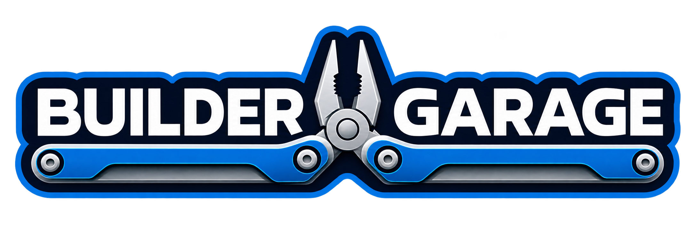

<p align="center">
  
</p>

**An Agentic Engineering System for Builders**

Builder Garage is an open-source, project-embedded, extensible agentic engineering framework: a system of engineering practices, standards, architecture, roles, contracts, and workflows for responsible software construction with AI agents.

## Project status

Builder Garage is at its foundation stage.

**What exists today** is the initial `garage` command-line foundation and the project's engineering documentation: the reusable engineering [skills](#skills), the [operating model](#operating-model) and review contract they implement, the [engineering principles](docs/principles.md) and [history](docs/history.md) behind them, and governance and contribution process.

The CLI can display help and version information, initialize, upgrade, and validate a project's `.garage/config.yaml`, and record private developer-local workflow events. It does not execute workflows, configure agents, connect to AI providers, load plugins, or provide remote services. No library, adapter, SDK, release automation, or runtime for the conceptual components has been implemented.

## Architectural direction

The approved direction is recorded in [docs/architecture.md](docs/architecture.md). In summary:

- **Project-embedded.** Builder Garage is meant to operate from inside the project it serves, alongside that project's repository, issues, and pull requests, rather than as a separate hosted service.
- **CLI-first.** The `garage` command-line interface is the primary interface. Libraries, adapters, and potentially independent or distributed execution may follow.
- **Extensible.** Projects that adopt it are expected to adapt and extend it.
- **Single repository**, initially.
- **Evolutionary.** Detailed design decisions are made through discovery within the lifecycle of the change that needs them, not in advance.

## The `garage` CLI

### Capabilities

The initial executable provides these entry points:

| Command | Behavior |
| --- | --- |
| `garage --help` | Describes Builder Garage and lists the available commands. |
| `garage version` | Reports the build version. Source builds report `dev` unless a version is supplied at link time. |
| `garage init` | Creates or upgrades `.garage/config.yaml` in the current project directory. See [Project configuration](#project-configuration). |
| `garage config validate` | Checks `.garage/config.yaml` against the configuration schema, read-only, and reports every problem. |
| `garage record` | Records a private workflow event, such as an implementation handoff or a review verdict, in this developer's local history. See [Local workflow history](#local-workflow-history). |

### Project configuration

`.garage/config.yaml` is the sole canonical source of a project's configured choices. Its `project` section holds the project's values at the extension points the [extension-point registry](docs/extension-points.md) declares. Its `tooling` section holds Garage tooling settings, which grant no workflow authority. The format and lifecycle are in [Project configuration](docs/configuration.md).

- **Required values.** Some choices have no default: discovery applicability, and the Workflow Owner, change acceptor, and product-intent acceptor. In an interactive terminal, `garage init` asks for each one that no flag supplies. Otherwise each must be given as a flag, and `init` fails and writes nothing if one is missing. `garage init --help` lists every flag.
- **Upgrade in place.** Running `garage init` again keeps every existing value and comment, adds only missing settings, and migrates a schema version 1 file to version 2. It never overwrites a configured value, and there is no `--force`. If the existing file is invalid, `init` stops without changing it and explains the correction required.
- **Validation.** `garage config validate` checks the schema and every mechanically checkable value. It does not certify that a configured authority is human, or anything about agents or workflow state.

Builder Garage's own configuration is generated by `garage init` and validated in CI; see its [skill-adoption profile](docs/skill-adoption.md#configuration).

### Local workflow history

`garage record` keeps a private, best-effort annotation of what a developer's agents did:

```sh
garage record --issue 39 --type implementation --outcome ready \
  --url https://github.com/OWNER/REPO/issues/39#issuecomment-123
```

- **Private and local.** Events are stored in the user cache directory, keyed to the repository, and are never written inside the repository or sent anywhere. The command works without GitHub access.
- **Bounded.** At most 500 events are kept per repository.
- **Minimal.** Only a timestamp, the repository key, the issue or pull request number, the event type, the outcome, an optional link to the durable GitHub record, and an optional artifact identity are stored. Branch names, prompts, conversation text, diffs, file contents, environment values, and tokens are not.
- **Not evidence.** GitHub Issue and pull request records are authoritative. Local history never authorizes, blocks, or advances work, and losing it loses nothing that matters.
- **Best effort.** If an event cannot be recorded, `garage record` prints a warning and still exits successfully.

Run `garage record --help` for the accepted event types and outcomes. The design is recorded in the [#19 decision](https://github.com/bdonaldharris/builder-garage/issues/19#issuecomment-6837362562).

### Build from source

Source builds require **Go 1.27.4**, the version declared in [`go.mod`](go.mod). Compiled executables are standalone and do not require a Go installation at run time.

Clone the repository, then build from its root:

```sh
go build ./cmd/garage
./garage --help
./garage version
```

The default version is `dev`. To supply a release-style version without adding a metadata framework:

```sh
go build -ldflags "-X main.version=1.2.3" ./cmd/garage
./garage version
```

The `Makefile` provides equivalent commands:

```sh
make build
make build VERSION=1.2.3
```

### Initialize another project

Run the compiled executable from the root of the project you want to initialize:

```sh
cd /path/to/project
/path/to/garage init
```

In a terminal, `init` asks for the required values. To supply them noninteractively:

```sh
/path/to/garage init --discovery implementer-judgment \
  --workflow-owner "lead maintainer" --change-acceptor maintainer \
  --product-intent-acceptor "Workflow Owner"
/path/to/garage config validate
```

This creates `/path/to/project/.garage/config.yaml`. Running `init` again leaves a complete configuration unchanged.

### Develop and validate

The repository uses Go's standard testing package. The focused checks are:

```sh
go test ./...
go vet ./...
make fmt-check
```

Run the full local validation, including a native build and cross-compilation:

```sh
make check
```

`make cross` writes executables for macOS, Linux, and Windows on amd64 and arm64 to `dist/`. On environments without `make`, the underlying commands are standard `go test`, `go vet`, `gofmt`, and `go build` commands; see [`Makefile`](Makefile) for the exact cross-compilation matrix. Pull requests run the same categories of validation in [GitHub Actions](.github/workflows/ci.yml), with tests on Linux, macOS, and Windows.

### Current limitations

- There are no published releases or installation packages yet.
- GoReleaser is an approved future direction, but it is not configured.
- The CLI initializes configuration and records local workflow history only; it does not implement Workbench, Crew, Inspection, Shipping, or Manuals capabilities.
- The canonical skills read `.garage/config.yaml` only through `garage config validate`, so an agent needs a `garage` binary on its `PATH` to resolve a configured value; there is no installation package yet. The configuration configures no agents, plugins, providers, or remote services.

## An engineering discovery journey, built in public

This repository documents an ongoing effort to discover, test, and refine practical engineering standards for building software with AI agents. It is being shared publicly so the journey is visible—not just its eventual conclusions.

The practices here emerge from real software construction: investigating systems, implementing changes, independently reviewing work, correcting defects, preparing releases, and examining where the process succeeds or fails. Lessons become candidate standards; candidate standards are tested against subsequent work and revised when the evidence warrants it.

This is **working engineering material, not a finished framework or a claim that every question has been settled**. Expect ideas to evolve, decisions to be revisited, and gaps to be documented. The repository captures both what the current operating model requires and why it has developed that way.

The central question is not simply how to generate software faster with AI. It is **how builders can retain engineering judgment, accountability, and reliable control of the software they construct while working with AI agents**.

The repository contains reusable engineering skills, operating contracts, documented standards, [engineering principles](docs/principles.md), and [project history](docs/history.md). Those artifacts are shared to make the reasoning and evolution of the practices inspectable and useful to other builders. They are not a substitute for evaluating the needs, constraints, and risks of a particular system.

## Inside the Garage

Builder Garage is the home for an evolving, builder-centered engineering system. Its shop vocabulary organizes responsibilities without replacing precise technical terminology or existing engineering contracts. The five shop areas are the framework's conceptual components.

| Shop area | Responsibility |
| --- | --- |
| **[Workbench](workbench/)** | Reusable engineering skills, workflows, procedures, and tools. |
| **[Crew](crew/)** | Distinct engineering agents with explicit responsibilities and handoff boundaries. |
| **[Inspection](inspection/)** | Independent reviews, tests, acceptance verification, and quality gates. |
| **[Shipping](shipping/)** | Pull request integration, release readiness, deployment requirements, and promotion. |
| **[Manuals](manuals/)** | Maintained technical guidance for designing and building with a particular technology, beginning with the [Go Manual](manuals/go.md). |

This is a **conceptual map**, not a required directory hierarchy or a new orchestration mechanism. Existing skill names, paths, invocation aliases, role boundaries, durable Issue/PR records, review contracts, and approval gates remain authoritative. The Garage can adopt automation selectively as practical needs and resources allow.

Each shop area's directory currently contains documentation of its responsibility and boundary; none contains an implementation. The Manuals directory also contains the baseline manuals themselves, which are guidance, not configuration. Builder Garage's own adoption of the Go Manual is recorded in [docs/go-manual.md](docs/go-manual.md).

## Operating model

The engineering system separates responsibilities deliberately:

- **Issue/PR = what + durable workflow history/state** — change-specific requirements, acceptance criteria, scope, constraints, implementation/discovery context, and the structured execution record produced by the agents.
- **Skill = how** — reusable workflow rules, role responsibilities, review boundaries, correction flow, reporting requirements, scope control, and recurring `DO NOT` instructions.
- **Prompt = action/location** — identify what should happen, where, and which skill to use.
- **Agent comments = structured execution state and historical record** — concise workflow-state comments make later agent invocations resumable without reconstructing context from chat history.

The current repository/PR artifact remains authoritative for what actually exists. Workflow-state comments record what agents did, found, and decided; they do not override source state.

When an agent is already operating in the correct repository workspace, ordinary prompts should stay extremely concise and should not duplicate issue content, prior workflow history, or workflow rules.

Examples:

```text
Implement FE #1510 using application-implementation-workflow
Review FE #1510 using indep-review
Correct FE #1510 using application-implementation-workflow
Re-review FE #1510 using indep-review
Assess FE #1510 using readiness-workflow
Discover FE #1510 using eng-discovery
Review PR #1501 using pr-review
```

Structured workflow-state comments use recognizable markers so agents can identify the latest relevant state without assuming the newest GitHub comment is the one that matters:

```text
[AGENT #1 — IMPLEMENTATION]
[AGENT #1 — CORRECTION]
[AGENT #2 — INDEPENDENT REVIEW]
```

Agents should read the governing Issue/PR, identify the latest relevant workflow-state comment for the current phase, inspect the current artifact, perform the skill-defined work, and write the resulting state back to the governing artifact.

For Agent #2 review, the durable record is mandatory. Agent #2 performs two distinct review sequences:

- **Implementation review** → write `[AGENT #2 — INDEPENDENT REVIEW]` to the **originating Issue**. Agent #2 reviews the complete implementation before it is committed. The issue record is the authoritative record of that review, and it governs whether the implementation may advance.
- **PR review**, when a PR-review trigger applies → write `[AGENT #2 — INDEPENDENT REVIEW]` to the **PR itself**. The PR record is supplemental. It never replaces the issue-recorded implementation review. The canonical skills define two minimum PR-review triggers: the PR cannot be shown to be artifact-equivalent to the latest Agent #2-approved artifact, or an optional automated reviewer has reported findings on the current head. A project may record additional triggers. Approvals rest on recorded artifact equivalence, not on head-SHA identity. When no trigger applies, the PR proceeds on the issue-recorded review and the remaining merge gates.

The Agent #2 invocation is not complete until that durable comment has been successfully written and verified. A review returned only in the agent response does not satisfy the workflow. If the durable write fails, Agent #2 must report the failure rather than claim the review state was recorded.

## Agent identity and role boundaries

Agent #1 and Agent #2 are distinct agents.

They are not personas, modes, phases, or interchangeable responsibilities of one agent.

A skill invocation establishes the executing agent's identity for that execution, and that identity remains fixed until the invocation ends.

- **Agent #1 — Implementation Agent** owns implementation, correction, implementation validation, artifact preparation, PR creation/finalization, and other implementation-side integration work assigned by the workflow.
- **Agent #2 — Independent Review Agent** owns independent complete-artifact review, disposition of implementation findings and of any automated-review findings, and approval/rejection under the governing three-question contract.

A transition between Agent #1 and Agent #2 requires a separate agent invocation. Agent #2 runs in its own execution context, such as a separate session or thread. It may use the same tool or model as Agent #1, but it never shares Agent #1's implementation context.

Reaching another agent's responsibility is a **terminal handoff boundary**, not permission for the current agent to assume that role. The current invocation ends at that boundary; it must not wait, poll, monitor, sleep/retry, or autonomously continue when the future state appears.

The role-specific workflow-state markers are owned by their corresponding agent:

- Agent #1 may write `[AGENT #1 — IMPLEMENTATION]`.
- Agent #1 may write `[AGENT #1 — CORRECTION]`.
- Agent #2 may write `[AGENT #2 — INDEPENDENT REVIEW]`.

An agent must never create a workflow-state comment representing the other agent.

The normal stop/handoff model is:

```text
Agent #1
→ implementation
→ READY FOR AGENT #2 REVIEW
→ STOP

separate Agent #2 invocation
→ independent complete-artifact review
→ write [AGENT #2 — INDEPENDENT REVIEW] to governing Issue/PR
→ verify durable record exists
→ APPROVED or CHANGES REQUIRED
→ STOP

if correction is required:

separate Agent #1 invocation
→ correction
→ READY FOR AGENT #2 RE-REVIEW
→ STOP
```

Review authority comes from the Agent #2 role and its durable record, not from tool choice. Codex or any other automated reviewer is optional review input where a project uses one. Implementation review requires no GitHub-hosted agent reviewer and no particular vendor integration.

An automated reviewer, such as Codex, is a review input, not Agent #2. Its review does not constitute independent Agent #2 review, its severity does not control disposition, and its returning no findings does not authorize Agent #1 to declare approval. When it reports findings, they trigger an Agent #2 PR review. Posting an Agent #2 PR Review Request is a terminal Agent #1 handoff: Agent #1 stops immediately and does not wait or poll. Only a separately invoked Agent #2 using `independent-implementation-review` may produce an Agent #2 disposition.

When automated findings exist, Agent #2's durable review comment explicitly accounts for every material finding with a concise identification, independent disposition, and reason tied to the three-question contract. `Not applicable` is used only when no applicable automated findings exist.

If Agent #2 requires correction, Agent #1 corrects and Agent #2 re-reviews the complete corrected artifact. `Yes -> No -> Yes = APPROVED — MERGE` is the final substantive correction approval for a PR review. Agent #1 may then commit/push only the exact reviewed artifact, verify artifact equivalence, and proceed to merge when the remaining gates pass. No further review is requested unless implementation code changes after Agent #2 approval; in that case, the changed artifact returns to Agent #2 review.

## Skill shorthand

Shorthand is an invocation alias only. The canonical skill remains the single source of workflow truth.

| Shorthand | Canonical skill |
| --- | --- |
| `implement-workflow` | `application-implementation-workflow` |
| `indep-review` | `independent-implementation-review` |
| `readiness-workflow` | `implementation-readiness-workflow` |
| `eng-discovery` | `engineering-discovery-workflow` |
| `pr-review` | `integration-pr-review` |

## Skills

Canonical reusable engineering procedures live under `skills/`.

- [`application-implementation-workflow`](skills/application-implementation-workflow/SKILL.md) (`implement-workflow`) — Executes as **Agent #1 — Implementation Agent** and governs scoped implementation/correction, durable Issue/PR workflow-state comments, environment/deployment requirement handoff, coherent issue-bound corrections, review handoff boundaries, the issue-recorded review as the authoritative review record, a supplemental Agent #2 PR review only when triggered, Agent #2-owned correction approval, artifact-equivalent finalization, and intentionally boring promotion.
- [`engineering-discovery-workflow`](skills/engineering-discovery-workflow/SKILL.md) (`eng-discovery`) — Governs evidence-based investigation of existing software systems before implementation, including capability classification, cross-layer tracing, gap analysis, and durable discovery reporting. Discovery is not complete until the complete report is recorded in the originating GitHub issue or in an accessible durable artifact directly linked from that issue, and the documentation has been verified.
- [`implementation-readiness-workflow`](skills/implementation-readiness-workflow/SKILL.md) (`readiness-workflow`) — Determines whether a defined change is sufficiently understood to implement responsibly by resolving material architectural, contract, data, authorization, integration, validation, and scope questions before coding begins.
- [`independent-implementation-review`](skills/independent-implementation-review/SKILL.md) (`indep-review`) — Executes as **Agent #2 — Independent Review Agent** and defines the narrow three-question review contract, complete-artifact review, required verified durable Issue/PR disposition comments, bounded sibling-state review, the supplemental PR-review procedure, and auditable independent disposition of every material automated-review finding. Agent #2 never performs implementation/correction work, and its invocation is not complete until the governing Issue/PR record has been successfully written and verified.
- [`integration-pr-review`](skills/integration-pr-review/SKILL.md) (`pr-review`) — Executes as **Agent #1 — Implementation Agent** for PR-side integration/finalization responsibilities. It governs durable PR workflow-state comments, artifact equivalence with the issue-approved change, the PR-review triggers and the role-based Agent #2 PR Review Request, hard Agent #2 disposition boundaries, required verified Agent #2 disposition on the PR itself when a PR review occurs, Agent #2-owned final correction approval, Environment / Deployment Requirements gating, and merge convergence without a post-correction review loop. Automated reviewers are optional input.

## Engineering principles

[docs/principles.md](docs/principles.md) separates the principles the skills and governance already require from evidence-backed candidate principles, which are not requirements, and from unresolved hypotheses. [docs/history.md](docs/history.md) records the engineering lineage those principles came from.

## Review contract

Application implementation review asks:

1. Was the issue acceptance criteria met?
2. Did the implementation introduce a new bug or regression?
3. Does the implemented behavior work?

`Yes -> No -> Yes` means approval. For an integration PR, it means merge once required CI and human approval are satisfied.

Non-blocking review observations belong in the application repository's persistent `Application Improvement Suggestions` backlog rather than automatically becoming standalone issues.

Application engineering should follow the relevant skill and durable GitHub workflow-state record rather than relying on conversational memory or ad hoc prompt reconstruction.

## Contributing

Builder Garage is maintainer-led and community-contributed. Contributions are welcome.

- **[CONTRIBUTING.md](CONTRIBUTING.md)** — how a change is proposed, reviewed, and merged.
- **[Open an issue](https://github.com/bdonaldharris/builder-garage/issues/new/choose)** — report a problem, propose a change, or request discovery. Substantive changes start from an issue.
- **[GOVERNANCE.md](GOVERNANCE.md)** — maintainer authority and how decisions are made.
- **[CODE_OF_CONDUCT.md](CODE_OF_CONDUCT.md)** — expected conduct.
- **[SECURITY.md](SECURITY.md)** — how to report a vulnerability privately.

A substantive change passes two distinct gates: **independent engineering review** before it is committed, and **maintainer approval** of the pull request before it is merged. Neither replaces the other.

## Contributors

Builder Garage was founded by B Donald Harris and is built with its community. Everyone whose contribution is merged is a contributor and is recognized in the repository's [contributors list](https://github.com/bdonaldharris/builder-garage/graphs/contributors).

## License

Builder Garage is released under the [MIT License](LICENSE), copyright © 2026 B Donald Harris. The license permits use, modification, and redistribution, including in proprietary derivative works.
